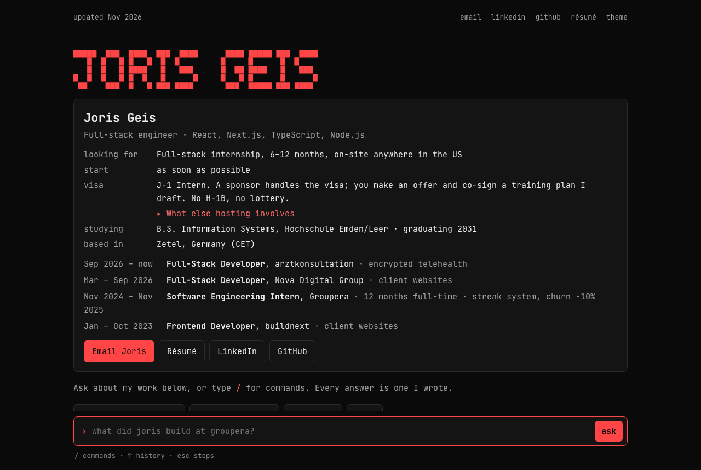
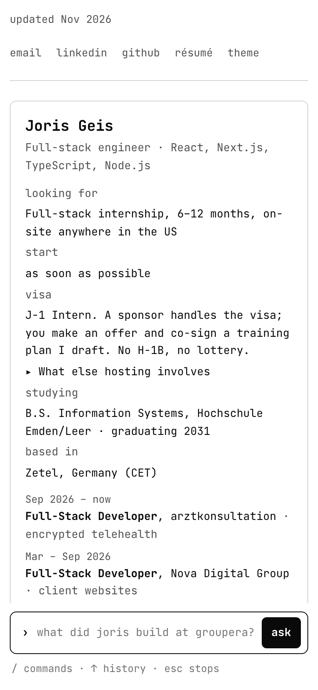

# Joris Geis: terminal portfolio

**Live:** [jorisgeis.de](https://jorisgeis.de)





## Why a terminal

Reviewers skim a portfolio in seconds, and a static page only answers the questions its author
predicted. So the key facts sit in a summary card that needs no typing: role, dates, visa, studies,
experience. Below it, a command line answers follow-up questions by matching keywords to answers
Joris wrote. Each answer is tied to a file you can open with `/cat`, so you can always see where it
came from.

## Key decision: no LLM

The first version used an LLM agent with tool calling. It was replaced with written answers, so
the page runs anywhere, costs nothing to host, and nothing a visitor types leaves the browser. The
only network requests are to Google Fonts. Analytics go through an optional `track()` hook that
calls `window.plausible` if it exists, and it never sends what anyone typed.

## Run it

Requires Node 20 or newer.

```bash
npm install
npm run dev        # http://localhost:5173
npm run build      # static site in dist/
npm run preview    # serve dist/
```

## Edit the content

Most edits happen in [`src/content/config.ts`](src/content/config.ts):

| Key            | What it does                                               |
| -------------- | ---------------------------------------------------------- |
| `START`        | Start date on the card and in answers                      |
| `LENGTH`       | Internship length                                          |
| `GRAD`         | Expected graduation year                                   |
| `CITIES`       | Where he can work                                          |
| `FEE`          | Who pays the sponsor fee. Empty hides the line on the card |
| `RESUME_URL`   | Résumé link. Empty hides the Résumé buttons                |
| `ARTIFACT_URL` | This repo's public URL. Empty hides the Code button        |

An empty value is hidden on the card and answered as "not written yet".

- The files you can open with `/cat` are in [`src/content/files.ts`](src/content/files.ts). A line
  holding a `[PLACEHOLDER IN CAPS]` is hidden and listed under "Not written yet: …" instead.
- The answers are ordered rules in [`src/content/answers.ts`](src/content/answers.ts). The first
  match wins, so keep specific questions first, broad keywords last and the catch-all at the end.
  When you add a rule, add its question to the table in `src/lib/route.test.ts`.
- Slash commands are in [`src/lib/commands.ts`](src/lib/commands.ts).

## Tests

```bash
npm run typecheck
npm run lint        # ESLint + Prettier check
npm test            # Vitest + React Testing Library
npx playwright install chromium   # once
npm run test:e2e    # Playwright smoke test, desktop and 390px phone
```

CI runs all of these on every push and pull request (`.github/workflows/ci.yml`).

## Layout

```
src/
  content/   config.ts, files.ts, answers.ts
  lib/       route, placeholders, commands, linkify, theme, track
  hooks/     useTerminal: turns, history, answer playback, Escape to stop
  components/ SummaryCard, Terminal, Turn, CommandMenu, Suggestions, Banner
  styles/    global.css, ported as-is from reference.html
reference.html   the original single-file version this port matches
```
